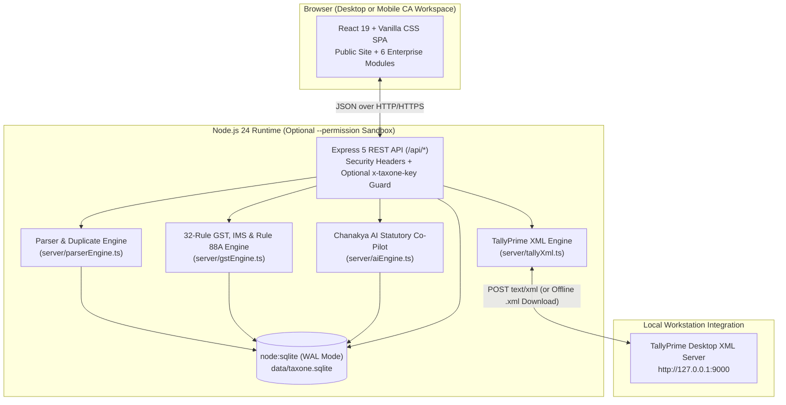
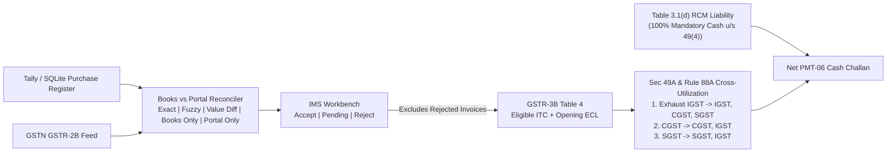

# Vyapar TaxOne — Full-Stack AI Pre-Accounting, TallyPrime Automation & GST Compliance Suite

> **Full-Stack Reconstruction of [`taxone.vyapar.com`](https://taxone.vyapar.com/) (formerly Suvit)** — reverse-engineered with [`morluto/rea`](https://github.com/morluto/rea) (`rea-agents` v6.9.0) and rebuilt end-to-end as a self-contained, local-first, security-hardened TypeScript platform powered by **React 19**, **Vanilla CSS**, **Express 5**, and **Node.js 24 built-in `node:sqlite`**.

---

## Table of Contents

1. [About the Project](#1-about-the-project)
   - [Domain Problem & Purpose](#11-domain-problem--purpose)
   - [`morluto/rea` Reverse-Engineering Provenance](#12-morlutorea-reverse-engineering-provenance)
   - [Complete Module & Feature Matrix](#13-complete-module--feature-matrix)
   - [Technology Stack & Architectural Principles](#14-technology-stack--architectural-principles)
2. [How It Works — Architecture & Engine Internals](#2-how-it-works--architecture--engine-internals)
   - [High-Level System Architecture](#21-high-level-system-architecture)
   - [TallyPrime `<ENVELOPE>` XML Bridge (`server/tallyXml.ts`)](#22-tallyprime-envelope-xml-bridge-servertallyxmlts)
   - [Banking Pre-Accounting, Smart Rules & Duplicate Guard (`server/parserEngine.ts`)](#23-banking-pre-accounting-smart-rules--duplicate-guard-serverparserenginets)
   - [Bulk Excel / E-Commerce 3-Step Wizard & Split-Pane Invoice OCR](#24-bulk-excel--e-commerce-3-step-wizard--split-pane-invoice-ocr)
   - [32-Rule Smart GST Validation & 1-Click Auto-Fix Engine (`server/gstEngine.ts`)](#25-32-rule-smart-gst-validation--1-click-auto-fix-engine-servergstenginets)
   - [GSTR-1 / 2A / 2B / IMS 4-View Reconciler & GSTR-3B Section 49A / Rule 88A Offset](#26-gstr-1--2a--2b--ims-4-view-reconciler--gstr-3b-section-49a--rule-88a-offset)
   - [TaxOne WhatsApp Chat, PMS, Drive Vault & Chanakya AI (`server/aiEngine.ts`)](#27-taxone-whatsapp-chat-pms-drive-vault--chanakya-ai-serveraienginets)
   - [SQLite Database Schema & REST API Reference](#28-sqlite-database-schema--rest-api-reference)
3. [How to Run & Operate in a Secure Environment](#3-how-to-run--operate-in-a-secure-environment)
   - [CA Practice Threat Model & Data Privacy](#31-ca-practice-threat-model--data-privacy)
   - [Node.js 24 Native Capability Sandbox (`npm run start:secure`)](#32-nodejs-24-native-capability-sandbox-npm-run-startsecure)
   - [Environment Variables, Loopback Binding & API Key Enforcement](#33-environment-variables-loopback-binding--api-key-enforcement)
   - [Securing the TallyPrime Port `9000` XML Connector](#34-securing-the-tallyprime-port-9000-xml-connector)
   - [Filesystem Isolation, Encryption-at-Rest & Atomic SQLite Backups](#35-filesystem-isolation-encryption-at-rest--atomic-sqlite-backups)
   - [Hardened Production Deployment (Read-Only Container, `systemd` & TLS Proxy)](#36-hardened-production-deployment-read-only-container-systemd--tls-proxy)
4. [Quickstart, Scripts & Automated Verification](#4-quickstart-scripts--automated-verification)
5. [Repository Structure](#5-repository-structure)

---

## 1. About the Project

### 1.1 Domain Problem & Purpose

Chartered Accountants (CAs), Tax Consultants, and SME finance teams in India spend thousands of hours each month manually:
- Keying PDF/Excel bank statement narrations (`NEFT`, `RTGS`, `UPI`, bank charges, contra withdrawals) into **TallyPrime**;
- Mapping multi-state e-commerce spreadsheets (**Amazon MTR**, **Flipkart**, **Meesho**) into intra-state (`CGST + SGST`) vs inter-state (`IGST`) vouchers;
- Auditing invoices for 15-character **GSTIN Modulo-36 checksum** typos, mandatory **6-digit HSN/SAC** codes, and Place-of-Supply tax-head mismatches;
- Reconciling Tally purchase registers against **GSTR-2B** and taking **Invoice Management System (IMS)** `Accept` / `Pending` / `Reject` actions before computing **GSTR-3B** input tax credit offsets;
- Chasing clients over WhatsApp for missing bank statements and supplier invoices.

**Vyapar TaxOne** (the post-acquisition rebrand of **Suvit Fintech**) unifies all of those workflows into a single CA Practice Platform. This repository provides a **complete, self-hosted, transparent, full-stack implementation** of the entire product — enabling CAs, developers, and security-conscious accounting firms to run the entire automation stack locally on their own hardware with zero external cloud lock-in.

### 1.2 `morluto/rea` Reverse-Engineering Provenance

The product surface, route hierarchy, microservice contracts, and GST rule catalog were recovered from `https://taxone.vyapar.com/` and `https://taxone.vyapar.com/app/signIn` using [`morluto/rea`](https://github.com/morluto/rea) (`rea-agents` v6.9.0). Every stage produced verifiable cryptographic Evidence IDs and SHA-256 digests:

| Stage | REA Operation | Cryptographic Evidence ID | Subject / Capture SHA-256 | Recovered Artifact |
| :--- | :--- | :--- | :--- | :--- |
| 1 | `capture_browser_scenario` | `ev_ab6ef1990289e36ef8d15c177460602c397d0eba5f6cf25e40065041924a5bf9` | `6b7047a773d29b3d62615c754bcd5be83b1c9c84b6e3da5777130b43f3ca4850` | Public Next.js DOM, CSS tokens & HAR |
| 2 | `export_web_scripts` | `ev_f61ac8d04417db3f79e760bd185705344b751998ea8d43b971e1bb021f268112` | `783b33e3f4c5ac353a8d4e0d01cdfe6bf6b8431c4eb7e051447f413aa0ae56f1` | 22 Next.js client chunks (`_next/static/chunks/*`) |
| 3 | `analyze_javascript_application` | `ev_883ac2a8a95464a7bfe5b751c3128c8f1f25c79b6c8b1db537f203bda6f500e6` | `783b33e3f4c5ac353a8d4e0d01cdfe6bf6b8431c4eb7e051447f413aa0ae56f1` | 20 public routes, pricing & calculator specs |
| 4 | `capture_browser_scenario` | `ev_1e2972dbf12bab643311b13307a5db9d186625f557214f53e280dd6936473dd1` | `7dbeb51c43d7addd809fffc8bb2d537ae80eff8a06c5d8b7b060b1cb7381c309` | 64 MiB network capture of `/app/signIn` |
| 5 | `export_web_scripts` | `ev_fa905b773e33ca4fc6f96ce1f2d94177cd607346fe243618e21f2aabbde17564` | `9ec0d4795b749391801670a94672954f5332b036f2c28a47465ee6385e9e36b6` | Monolithic SPA bundle `main.060bc231.js` (`20.04 MB`) |
| 6 | `analyze_javascript_application` | `ev_e41ed5624ad396558d96b81d47852015bac6ebc34d4c12a9abb68a24f9e0a854` | `9ec0d4795b749391801670a94672954f5332b036f2c28a47465ee6385e9e36b6` | 181 SPA route patterns, 50+ APIs, 32 GST rules |

See [`docs/REA_RECONSTRUCTION_REPORT.md`](./docs/REA_RECONSTRUCTION_REPORT.md) or open `/app/rea-evidence` inside the running application for the interactive provenance explorer.

### 1.3 Complete Module & Feature Matrix

| Surface / Module | Primary Routes | Implemented Capabilities |
| :--- | :--- | :--- |
| **Public Site & Calculators** | `/`, `/data-entry-automation-feature`, `/gst-reconciliation-feature`, `/taxone-chat`, `/pricing`, `/calculators`, `/contact-us` | Interactive Pre-Accounting hero workbench, 1-Yr vs 3-Yr pricing & ROI estimator, **8 live statutory calculators** (GST Split, 2026 6-Digit HSN/SAC Finder, FY 2025-26 New vs Old Income Tax, Salary CTC, Gratuity `15/26`, PPF, FD + `194A` TDS, RD). |
| **1. Practice Home & RBAC** | `/app/home/dashboard`, `/app/home/company`, `/app/home/clients`, `/app/home/users`, `/app/activity-log` | Multi-company GSTIN & FY switcher, Subscribed Tally/Vyapar company manager, Tally Port `9000` & GST Portal status, Client WhatsApp directory, Staff RBAC (`Admin`, `Audit Head`, `GST Executive`, `Article Assistant`), immutable Audit Log. |
| **2. Data Entry Automation** | `/app/da/banking`, `/app/da/rulelist`, `/app/da/sales`, `/app/da/purchase`, `/app/da/add-vouchers`, `/app/da/ledger-master`, `/app/da/vyapar` | `.xlsx`/`.csv` Bank Statement upload, Smart Keyword Rules + Cross-Company Cloning, Orange-Flag Duplicate Guard, 3-Step Excel/Amazon Column-to-Tally Wizard, Split-Pane AI Bill OCR, Manual Cloud Vouchers & Journal, Ledger/Stock Item Masters + Cloning, 1-Click Vyapar App Sync. |
| **3. GST & IMS Compliance** | `/app/ga/dashboard`, `/app/ga/audit/reviewAndFix`, `/app/ga/audit/ims`, `/app/ga/audit/gstr1`, `/app/ga/return-filing`, `/app/ga/gstr3b-filing`, `/app/ga/notice-order` | **32 Smart GST Validations** + 1-Click SQLite Auto-Fix, **GSTR-1/2A/2B Reconciliation** across Summary/Month/Voucher/Vendor views, live **IMS (`Accepted`/`Pending`/`Rejected`)** ITC recalculation, Official GSTN **GSTR-1 `.json`** export, **GSTR-3B Section 49A / Rule 88A** offset & `PMT-06` cash calculator, Notice Tracker (`ASMT-10`, `DRC-01`). |
| **4. TaxOne WhatsApp Chat** | `/app/chat` | Shared CA team WhatsApp client inbox, staff attribution, **1-click attachment routing** to `Banking`/`Sales`/`Purchase`/`Drive`, automated monthly reminder templates & scheduler. |
| **5. Practice PMS Tasks** | `/app/pms` | Compliance task board linked to GST deadlines, staff assignees, priority tags, and workflow stages (`Todo` -> `In Progress` -> `Completed`). |
| **6. Drive & Chanakya AI** | `/app/drive`, `/app/chanakya-ai` | Client statutory document vault with transfer `Accept`/`Reject` approvals + **Chanakya AI (CA GPT)** grounded on live SQLite books and Indian GST/Income-Tax statutes. |

### 1.4 Technology Stack & Architectural Principles

- **Frontend**: React `19.3`, React Router `7`, TypeScript `~7.0` (`erasableSyntaxOnly: true`, `verbatimModuleSyntax: true`), Lucide Icons, and a custom **Vanilla CSS Dual-Surface Design System** (`src/index.css` — warm cream/crimson public brand + high-density cobalt/slate tabular workspace with `font-variant-numeric: tabular-nums`).
- **Backend**: Express `5.3` + **Node.js 24 native TypeScript execution** (`node server/standalone.ts` — no fragile runtime transpiler step required).
- **Database**: **Node.js 24 built-in `node:sqlite`** (`DatabaseSync` running in `WAL` journal mode with `foreign_keys = ON`) — zero native C++ `node-gyp` build issues and zero external database servers to secure.
- **Spreadsheet Engine**: SheetJS (`xlsx`) parsing real `.xlsx`, `.xls`, and `.csv` bank statements and e-commerce registers in memory.
- **Testing & Linting**: `vitest` (`npm test`) and `oxlint` (`npm run lint`).

---

## 2. How It Works — Architecture & Engine Internals

### 2.1 High-Level System Architecture



In development (`npm run dev`), Vite's `configureServer` hook in `vite.config.ts` mounts `createApiApp()` directly on the same port (`5173`), eliminating CORS complexity. In production (`npm start` or `npm run start:secure`), `server/standalone.ts` serves both the compiled `dist/` static bundle and `/api/*` from a single hardened Node 24 process.

---

### 2.2 TallyPrime `<ENVELOPE>` XML Bridge (`server/tallyXml.ts`)

TallyPrime's built-in XML import server (`<TALLYREQUEST>Import Data</TALLYREQUEST>`) enforces strict double-entry sign semantics inside `<ALLLEDGERENTRIES.LIST>`:
- **Debit (`Dr`) legs** MUST set `<ISDEEMEDPOSITIVE>Yes</ISDEEMEDPOSITIVE>` and carry a **negative** `<AMOUNT>` (e.g., `-295000.00`).
- **Credit (`Cr`) legs** MUST set `<ISDEEMEDPOSITIVE>No</ISDEEMEDPOSITIVE>` and carry a **positive** `<AMOUNT>` (e.g., `250000.00` Sales + `22500.00` Output CGST + `22500.00` Output SGST).
- Across every `<VOUCHER>`, the algebraic sum of all `<AMOUNT>` nodes must equal **`0.00`** or TallyPrime aborts the import with a voucher imbalance error.

`server/tallyXml.ts` implements:
1. **`generateTallyMastersXml`**: Emits `<REPORTNAME>All Masters</REPORTNAME>` containing `<LEDGER>` (Parent Group, `ISBILLWISEON`, State, `GSTREGISTRATIONTYPE`, `PARTYGSTIN`, Opening Balance) and `<STOCKITEM>` (`BASEUNITS`, `HSNDETAILS.LIST`, `GSTDETAILS.LIST` splitting `IGST` vs `CGST`/`SGST`).
2. **`generateTallyVouchersXml` & `generateBankTransactionsTallyXml`**: Emits balanced `<VOUCHER>` envelopes across `Sales`, `Purchase`, `Credit Note`, `Debit Note`, `Payment`, `Receipt`, `Contra`, and `Journal`, plus `<ALLINVENTORYENTRIES.LIST>` when item lines exist.
3. **`pushXmlToTallyConnector`**: Attempts a `POST` (`Content-Type: text/xml; charset=utf-8`, `900ms` timeout) to `http://127.0.0.1:<tally_connector_port>`. If TallyPrime is open locally on port `9000`, vouchers import live; if offline or cloud-hosted, it queues cleanly and opens the interactive XML Preview & `.xml` Download modal.

---

### 2.3 Banking Pre-Accounting, Smart Rules & Duplicate Guard (`server/parserEngine.ts`)

When a CA uploads a bank statement (`.xlsx`, `.xls`, `.csv`):
1. **Header Normalization**: Automatically detects `Date`, `Narration`/`Particulars`, `Ref/UTR`, `Withdrawal`/`Debit`, `Deposit`/`Credit`, and `Closing Balance` columns across HDFC, ICICI, SBI, and Axis formats.
2. **Pipe-Delimited Smart Keyword Rules (`matchBankRule`)**: Evaluates active company rules ordered by `priority`, matching flow direction (`Withdrawal` / `Deposit` / `Both`) and pipe-separated keywords (e.g., `DGVCL|TORRENT POWER|ELECTRICITY` -> `Payment` -> `Electricity & DG Power Charges`). Rules can be **cloned across client companies** in one click (`POST /api/banking/rules/clone`).
3. **Orange-Flag Duplicate Guard**: Computes a deterministic transaction fingerprint (`YYYY-MM-DD | Withdrawal | Deposit | NormalizedNarration[0..28]`) against both existing database rows and earlier rows in the same file. Overlapping entries (common when clients send overlapping mid-month CSVs) are flagged with `is_duplicate = 1`, highlighted in amber in the UI, and **automatically excluded** from TallyPrime XML sync (`WHERE is_duplicate = 0`).

---

### 2.4 Bulk Excel / E-Commerce 3-Step Wizard & Split-Pane Invoice OCR

- **Bulk Column Mapping (`mapBulkRowsToVouchers`)**: Parses multi-thousand-row Sales, Purchase, or E-Commerce (`Amazon`, `Flipkart`, `Meesho`) sheets, maps arbitrary user columns to Tally fields, extracts the 2-digit destination state code from `Place of Supply` or `Party GSTIN`, and compares it against the active company's `state_code`:
  - **Intra-State (`destState === company.state_code`)**: Splits tax `50/50` into `CGST` + `SGST`.
  - **Inter-State (`destState !== company.state_code`)**: Allocates `100%` of tax to `IGST`.
- **AI Invoice OCR Extractor (`extractInvoiceViaOcr`)**: Scans invoice text/metadata for 15-character GSTIN candidates (preferring Modulo-36 valid matches), invoice numbers, dates, 6/8-digit HSN codes, and taxable subtotals, presenting a side-by-side verification pane before saving to SQLite.

---

### 2.5 32-Rule Smart GST Validation & 1-Click Auto-Fix Engine (`server/gstEngine.ts`)

Before generating GSTR-1 or GSTR-3B, `runSmartGstValidations` audits all outward and inward vouchers across **32 statutory Indian GST compliance rules** grouped into 7 categories:

1. **GSTIN & Registration (`R01`–`R02`)**: Official 15-character structure (`2-digit State` + `10-char PAN` + `Entity Code` + `Z` + **Modulo-36 check digit** over `0-9A-Z` with alternating weights `1, 2`) and Self-GSTIN guard.
2. **Place of Supply & Tax Head (`R03`–`R07`)**: GSTIN state vs POS alignment, Intra-State booked with `IGST` error, Inter-State booked with `CGST/SGST` error, `CGST === SGST` symmetry, and simultaneous `IGST + CGST` conflict.
3. **HSN & Rate Slab (`R08`–`R11`, `R31`)**: Mandatory CBIC 4/6/8-digit HSN presence for Table 12, notified GST slabs (`0%, 3%, 5%, 12%, 18%, 28%`), `Taxable × Rate` arithmetic check (`> ₹1` variance), and Nil-Rated zero-tax consistency.
4. **Invoice & Document Rules (`R12`–`R17`, `R21`–`R22`, `R30`)**: Rule 46 max 16-character invoice limit, GSTN character whitelist (`A-Z0-9/-`), duplicate sales invoice guard, duplicate supplier bill double-ITC guard, positive taxable check, gross total reconciliation, FY boundary, future-date block, and Journal equilibrium.
5. **B2B / B2CL / Credit Notes (`R18`–`R20`, `R26`)**: Inter-state unregistered `B2CL > ₹2.5L` POS check, `CDNR` original invoice link, Credit Note ceiling, and e-Invoice readiness.
6. **RCM & Section 9(5) E-Commerce (`R23`–`R25`)**: E-Commerce Operator TCS GSTIN validation, Section 9(3) GTA/Legal (`SAC 9965/9982/9985` @ 5%) RCM detection, and RCM self-tax computation.
7. **ITC & Electronic Credit Ledger (`R27`–`R29`, `R32`)**: Section 17(5) blocked credit screening (motor vehicles `8703`, F&B `996331`), unregistered vendor ITC guard, Rule 86B (`> ₹50L/month` 99% ITC cap), and Electronic Credit Ledger sufficiency.

Clicking **1-Click Auto-Fix** invokes `autoFixGstIssue`, which deterministically repairs Modulo-36 checksum typos, converts `IGST <-> CGST+SGST` based on POS, sanitizes invoice numbers, or assigns valid 6-digit HSN codes directly in SQLite.

---

### 2.6 GSTR-1 / 2A / 2B / IMS 4-View Reconciler & GSTR-3B Section 49A / Rule 88A Offset



- **4-View Reconciliation (`reconcileGstBooksVsPortal`)**: Matches Tally vouchers against GSTN portal invoices (exact GSTIN + invoice number first, then normalized alphanumeric fuzzy matching) and aggregates results into **Summary View**, **Month View**, **Voucher View**, and **Vendor Compliance Scorecard**.
- **Statutory GSTR-3B Offset (`computeGstr3bSummary`)**: Implements **Section 49A, Section 49B, and Rule 88A of the CGST Rules, 2017**:
  1. **IGST Credit Pool** (Opening ECL + Current IMS-Eligible 2B + RCM ITC) is **100% exhausted first** against `Output IGST` -> `Output CGST` -> `Output SGST`.
  2. **CGST Credit Pool** offsets remaining `Output CGST` -> remaining `Output IGST` *(never SGST)*.
  3. **SGST Credit Pool** offsets remaining `Output SGST` -> remaining `Output IGST` *(never CGST)*.
  4. **Reverse Charge Liability (`Table 3.1(d)`)** bypasses ITC pools completely and is added directly to the **Net PMT-06 Cash Challan** per Section 49(4).

---

### 2.7 TaxOne WhatsApp Chat, PMS, Drive Vault & Chanakya AI (`server/aiEngine.ts`)

- **WhatsApp Document Routing (`POST /api/chat/forward-document`)**: Files shared by clients in WhatsApp threads can be routed in 1 click to `Banking`, `Sales`, `Purchase`, or `Drive`, updating message attribution and archiving the file in `drive_documents`.
- **Chanakya AI (`askChanakyaAi`)**: Queries the active company's live SQLite tables (`vouchers`, `gstr_portal_invoices`, `bank_transactions`), runs the 32-rule validator and GSTR-3B offset calculator on the fly, and pairs live company numbers with Indian statutory citations (**Section 43B(h) MSME 15/45-day deduction rule**, **Section 16(2)(aa)**, **Rule 86B**, **Rule 88A**). Notice that Chanakya AI runs **100% locally** without transmitting client books to external LLM APIs.

---

### 2.8 SQLite Database Schema & REST API Reference

**15 Persistent SQLite Tables (`server/db.ts`)**:
`users`, `companies`, `clients`, `ledgers`, `stock_items`, `bank_rules`, `bank_transactions`, `vouchers`, `gstr_portal_invoices`, `gst_notices`, `chat_threads`, `chat_messages`, `reminder_templates`, `scheduled_reminders`, `pms_tasks`, `drive_documents`, `activity_logs`.

| Endpoint Group | Method & Path | Description |
| :--- | :--- | :--- |
| **Health & Auth** | `GET /api/health`, `POST /api/auth/login`, `POST /api/auth/register`, `GET/POST /api/auth/users` | Runtime health check, CA session login, staff RBAC provisioning. |
| **Practice & Masters** | `GET/POST/PATCH /api/companies`, `GET/POST /api/clients`, `GET /api/dashboard`, `GET/POST /api/ledgers`, `POST /api/ledgers/clone`, `GET/POST /api/items`, `POST /api/items/clone` | Subscribed companies, KPIs, Tally party/stock masters, cross-company cloning. |
| **Banking & Rules** | `GET/PATCH/DELETE /api/banking/transactions`, `POST /api/banking/upload`, `POST /api/banking/apply-rules`, `GET/POST /api/banking/rules`, `POST /api/banking/rules/clone` | Spreadsheet statement ingestion, duplicate detection, smart keyword rules. |
| **Vouchers & OCR** | `GET/POST/DELETE /api/vouchers`, `POST /api/vouchers/parse-sheet`, `POST /api/vouchers/bulk-import`, `POST /api/vouchers/ocr-extract`, `POST /api/vyapar/sync` | Cloud vouchers, 3-step bulk column mapper, AI invoice OCR, Vyapar sync. |
| **Tally XML Bridge** | `GET /api/tally/xml/masters`, `POST /api/tally/sync/vouchers`, `POST /api/tally/sync/banking` | Balanced TallyPrime `<ENVELOPE>` XML generation & port `9000` push. |
| **GST & IMS** | `GET /api/gst/validations`, `POST /api/gst/validations/fix`, `GET /api/gst/reconcile`, `PATCH /api/gst/ims/:portalId`, `GET /api/gst/gstr1`, `GET /api/gst/gstr3b`, `GET/POST /api/gst/notices` | 32-rule GST audit + auto-fix, 4-view reconciliation, IMS actions, GSTR-1 JSON, GSTR-3B offset, notice tracker. |
| **Collab & AI** | `GET /api/chat/threads`, `GET/POST /api/chat/threads/:id/messages`, `POST /api/chat/forward-document`, `GET/POST /api/chat/reminders`, `GET/POST/PATCH /api/pms/tasks`, `GET/POST/PATCH /api/drive/documents`, `POST /api/chanakya/ask` | WhatsApp client inbox, reminders, PMS tasks, Drive vault, Chanakya AI. |

---

## 3. How to Run & Operate in a Secure Environment

Accounting practices handle highly regulated financial records: **PANs**, **15-digit GSTINs**, **bank account statements**, **party ledgers**, and **unpublished turnover figures**. This codebase is engineered from the ground up to run inside **strictly isolated, air-gapped, or private-LAN environments**.

### 3.1 CA Practice Threat Model & Data Privacy

- **Zero Third-Party Cloud Persistence**: All accounting vouchers, bank statements, chat threads, and Chanakya AI computations execute locally against `data/taxone.sqlite`. No financial data is sent to external SaaS APIs or external LLM endpoints.
- **Immutable Audit Trail**: Sensitive state transitions (Tally XML syncs, IMS `Reject` actions, GST auto-fixes, rule cloning, staff invitations) are recorded in `activity_logs`.
- **Built-in HTTP Security Headers (`server/api.ts`)**: Every response strips `X-Powered-By` and enforces `X-Content-Type-Options: nosniff`, `X-Frame-Options: SAMEORIGIN`, `Referrer-Policy: strict-origin-when-cross-origin`, `Cross-Origin-Opener-Policy: same-origin`, `Permissions-Policy: camera=(), microphone=(), geolocation=()`, dotfile denial (`dotfiles: 'deny'`), and a `10mb` JSON payload ceiling.

### 3.2 Node.js 24 Native Capability Sandbox (`npm run start:secure`)

Node.js 24 includes a kernel-style **Runtime Permission Model (`--permission`)**. Running `npm run start:secure` launches the production server inside a least-privilege capability sandbox:

```bash
npm run build
npm run start:secure
```

Under the hood, `start:secure` executes:

```bash
mkdir -p data && \
BIND_HOST=127.0.0.1 \
node --permission \
  --allow-fs-read=. \
  --allow-fs-write=./data \
  server/standalone.ts
```

What this enforces at the V8/Node runtime boundary:
- **Filesystem Write Lock**: The process can **only** write inside `./data/` (for `taxone.sqlite`, `-wal`, and `-shm`). Any attempt to modify source files, `dist/`, `~/.ssh`, `/tmp`, or system directories throws `ERR_ACCESS_DENIED`.
- **Filesystem Read Lock**: The process cannot read `/etc`, `$HOME`, or parent directories outside the application folder.
- **No Shell / Subprocess Spawning**: `--allow-child-process` is omitted, completely blocking `child_process.exec` / `spawn` RCE vectors.
- **No Native Addon Injection or Worker Escapes**: `--allow-addons` and `--allow-worker` are omitted (built-in `node:sqlite` requires zero external `.node` binaries).
- **Loopback-Only Network Binding**: `BIND_HOST=127.0.0.1` prevents LAN/WAN exposure unless explicitly fronted by an authenticated TLS reverse proxy.

### 3.3 Environment Variables, Loopback Binding & API Key Enforcement

Configure runtime behavior via environment variables (never commit secrets to `.env` — `.gitignore` excludes `.env` and `data/*.sqlite*`):

| Variable | Default | Secure Production Recommendation |
| :--- | :--- | :--- |
| `PORT` | `4173` | `4173` behind reverse proxy |
| `BIND_HOST` | `0.0.0.0` (`127.0.0.1` in `start:secure`) | Always set `127.0.0.1` unless inside an isolated container network |
| `TAXONE_DB_PATH` | `./data/taxone.sqlite` | Dedicated encrypted volume path (e.g., `/var/lib/taxone/taxone.sqlite`) |
| `TAXONE_API_KEY` | *(unset)* | Set a 32-byte random secret (`openssl rand -hex 32`) when exposing `/api/*` to automated scripts or reverse proxies; requires `x-taxone-key` header on every `/api/*` request except `/api/health` |

### 3.4 Securing the TallyPrime Port `9000` XML Connector

TallyPrime's HTTP XML Server (`Port 9000`) accepts unauthenticated `<ENVELOPE>` XML imports by default if exposed on a LAN. Follow these rules on the workstation running TallyPrime:

1. **Bind TallyPrime to Localhost Only**:
   - In TallyPrime, press `F1` (Help) -> **Settings** -> **Connectivity** -> **Client/Server Configuration**.
   - Enable TallyPrime as `Both` or `Server` on Port `9000`, and ensure Windows Defender Firewall **blocks inbound TCP `9000` on Public and Private/LAN profiles**, allowing **only loopback (`127.0.0.1`)**.
2. **Remote CA Firm Server -> Client Tally Desktop**:
   - Never port-forward TCP `9000` over the public internet.
   - Either use **Offline XML Mode** (download the verified `.xml` envelope from Vyapar TaxOne and import via TallyPrime `Alt+O` -> `Import` -> `Masters` / `Transactions`), OR establish a **WireGuard / SSH Local Port Forward** (`ssh -L 9000:127.0.0.1:9000 user@tally-host`).
3. **Always Backup Tally Data (`Alt+Y` -> `Backup`)** before bulk master or voucher imports.

### 3.5 Filesystem Isolation, Encryption-at-Rest & Atomic SQLite Backups

```bash
# 1. Restrict SQLite data directory permissions to the service account only
mkdir -p data
chmod 700 data
chmod 600 data/taxone.sqlite* 2>/dev/null || true

# 2. Safe hot backup while WAL mode is active (uses Node 24 without corrupting WAL frames)
node -e '
import { DatabaseSync } from "node:sqlite";
const db = new DatabaseSync("./data/taxone.sqlite");
db.exec("VACUUM INTO '\''./data/backup-taxone-" + new Date().toISOString().slice(0,10) + ".sqlite'\''");
db.close();
'
```

- **Encryption at Rest**: Store `TAXONE_DB_PATH` on an OS-encrypted volume (**LUKS/dm-crypt** on Linux, **BitLocker** on Windows, or **FileVault** on macOS).
- **Dependency Supply-Chain Hygiene**: Install dependencies deterministically in CI/production with `npm ci --ignore-scripts` so third-party `postinstall` hooks cannot execute arbitrary shell commands.

### 3.6 Hardened Production Deployment (Read-Only Container, `systemd` & TLS Proxy)

#### Option A: Hardened Non-Root Read-Only Container (Docker / Podman)

```dockerfile
# Dockerfile.secure
FROM node:24-bookworm-slim AS build
WORKDIR /app
COPY package.json package-lock.json ./
RUN npm ci --ignore-scripts
COPY . .
RUN npm run build && npm prune --omit=dev

FROM node:24-bookworm-slim
WORKDIR /app
ENV NODE_ENV=production
ENV PORT=4173
ENV BIND_HOST=0.0.0.0
ENV TAXONE_DB_PATH=/data/taxone.sqlite
COPY --from=build --chown=node:node /app/package.json ./
COPY --from=build --chown=node:node /app/node_modules ./node_modules
COPY --from=build --chown=node:node /app/dist ./dist
COPY --from=build --chown=node:node /app/server ./server
VOLUME ["/data"]
USER node
EXPOSE 4173
CMD ["node", "--permission", "--allow-fs-read=/app", "--allow-fs-read=/data", "--allow-fs-write=/data", "server/standalone.ts"]
```

Run with all Linux capabilities dropped and a read-only root filesystem:

```bash
docker build -f Dockerfile.secure -t vyapar-taxone:secure .
docker run -d \
  --name vyapar-taxone \
  --read-only \
  --cap-drop=ALL \
  --security-opt=no-new-privileges:true \
  -p 127.0.0.1:4173:4173 \
  -v taxone_encrypted_data:/data \
  vyapar-taxone:secure
```

#### Option B: Hardened Linux `systemd` Unit + TLS 1.3 Reverse Proxy

```ini
# /etc/systemd/system/vyapar-taxone.service
[Unit]
Description=Vyapar TaxOne CA Automation Server
After=network.target

[Service]
Type=simple
User=taxone
Group=taxone
WorkingDirectory=/opt/vyapar-taxone
Environment=NODE_ENV=production
Environment=BIND_HOST=127.0.0.1
Environment=PORT=4173
Environment=TAXONE_DB_PATH=/var/lib/vyapar-taxone/taxone.sqlite
ExecStart=/usr/local/bin/node --permission --allow-fs-read=/opt/vyapar-taxone --allow-fs-read=/var/lib/vyapar-taxone --allow-fs-write=/var/lib/vyapar-taxone server/standalone.ts
Restart=on-failure
NoNewPrivileges=true
ProtectSystem=strict
ProtectHome=true
PrivateTmp=true
PrivateDevices=true
ReadWritePaths=/var/lib/vyapar-taxone

[Install]
WantedBy=multi-user.target
```

Place **Caddy** or **Nginx** in front of `127.0.0.1:4173` bound exclusively to your CA firm's **WireGuard / Tailscale VPN** interface with TLS 1.3 and `Strict-Transport-Security` enabled.

---

## 4. Quickstart, Scripts & Automated Verification

### Prerequisites
- **Node.js `>= 24.0.0`** (uses built-in `node:sqlite` and native TypeScript type-stripping)
- **npm `>= 10`**

### Setup & Run

```bash
# 1. Clone the repository
git clone https://github.com/Sinr1/Tally_automation.git
cd Tally_automation

# 2. Install dependencies cleanly
npm install

# 3. Start full-stack development server (Frontend + Express + SQLite on port 5173)
npm run dev

# 4. Run the automated Vitest engine verification suite
npm test

# 5. Type-check (server + client) & build production assets
npm run build

# 6. Run hardened localhost production server inside Node 24 permission sandbox
npm run start:secure
```

### Available `npm` Scripts

| Command | Purpose |
| :--- | :--- |
| `npm run dev` | Starts Vite 8 HMR + Express 5 + `node:sqlite` single-port dev server (`5173`). |
| `npm test` | Runs `vitest` suite (`tests/engines.test.ts`) testing Modulo-36 GSTIN check digits, 32-rule GST validator & auto-fix, GSTR-2B/IMS & Rule 88A GSTR-3B offset, balanced Tally XML, and Banking duplicate detection. |
| `npm run build` | Runs `tsc -b` across both `tsconfig.app.json` and `tsconfig.node.json` + builds `dist/`. |
| `npm run lint` | Runs `oxlint` static analysis across client and server TypeScript files. |
| `npm start` | Starts `server/standalone.ts` serving `dist/` and `/api/*` on `PORT` (default `4173`). |
| `npm run start:secure` | Runs `server/standalone.ts` bound to `127.0.0.1` inside Node 24's `--permission` filesystem & process capability sandbox. |

---

## 5. Repository Structure

```text
Tally_automation/
├── docs/
│   └── REA_RECONSTRUCTION_REPORT.md   # Cryptographic morluto/rea Evidence IDs & SHA-256 digests
├── public/
│   └── favicon.svg                    # Vyapar TaxOne brand mark
├── server/
│   ├── aiEngine.ts                    # Chanakya AI (CA GPT) live SQLite & statutory assistant
│   ├── api.ts                         # Express 5 REST API + security headers & optional API key guard
│   ├── db.ts                          # Node 24 node:sqlite (WAL) schema & Indian CA firm seed data
│   ├── gstEngine.ts                   # Modulo-36 GSTIN, 32 GST rules + auto-fix, IMS reco, GSTR-1/3B
│   ├── parserEngine.ts                # XLSX/CSV parser, Smart Bank Rules, Duplicate Guard & Bill OCR
│   ├── standalone.ts                  # Production static + API HTTP server
│   ├── tallyXml.ts                    # TallyPrime <ENVELOPE> XML generator & Port 9000 bridge
│   └── types.ts                       # Shared strict backend TypeScript interfaces
├── src/
│   ├── components/
│   │   ├── BrandLogo.tsx              # Vyapar TaXOne wordmark
│   │   ├── PublicLayout.tsx           # Public header, mobile menu & CA resource footer
│   │   └── WorkspaceLayout.tsx        # 8-tab CA topbar, company switcher & Tally XML modal
│   ├── context/
│   │   └── WorkspaceContext.tsx       # Active CA persona, company context & global notifications
│   ├── data/
│   │   └── reaEvidence.ts             # REA Evidence Chain, microservice map & 2026 HSN directory
│   ├── pages/
│   │   ├── CalculatorsPage.tsx        # 8 interactive tax/financial calculators + HSN 2026 search
│   │   ├── DataAutomationPages.tsx    # Banking, Rules, Sales/Purchase Excel Wizard, OCR, Masters
│   │   ├── GstAutomationPages.tsx     # GST Hub, 32 Validations, 4-View IMS Reco, GSTR-1 & 3B
│   │   ├── HomeModulePages.tsx        # Practice Dashboard, Companies, Clients, RBAC, Audit Log
│   │   ├── PracticeCollabPages.tsx    # TaxOne WhatsApp Chat, PMS, Drive, Chanakya AI, REA View
│   │   └── PublicPages.tsx            # Public Home, Feature pages, Pricing, Contact & Auth
│   ├── App.tsx                        # Complete public + authenticated SPA route map
│   ├── index.css                      # Vanilla CSS dual-surface design system
│   └── main.tsx                       # React 19 root entrypoint
├── tests/
│   └── engines.test.ts                # Automated Vitest suite for GST, Tally XML & Banking engines
├── index.html                         # HTML shell & typography imports
├── package.json                       # Dependencies & build/test/secure scripts
├── tsconfig.app.json                  # Strict client TypeScript 7 config
├── tsconfig.node.json                 # Strict server & test TypeScript 7 config
└── vite.config.ts                     # Single-port Vite + Express middleware integration
```
